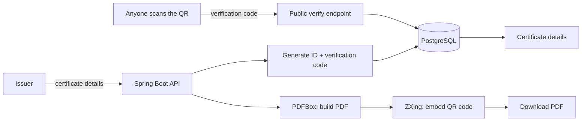

<h1 align="center">📜 Smoly</h1>

<p align="center">
  Generate certificates that anyone can verify in seconds.<br/>
  Create a PDF, embed a QR code, and let anyone check it's real. A URL shortener is built in too.
</p>

<p align="center">
  
  
  
  
  
</p>

<p align="center">
  <a href="https://smoly.onrender.com/"><b>▶ Live demo</b></a> ·
  <a href="#-how-it-works">How it works</a> ·
  <a href="#-run-it-locally">Run locally</a>
</p>
<p align="center"><sub>Hosted on a free plan, so the first load can take about a minute to wake up.</sub></p>

<p align="center">
  
</p>

---

## 🎯 The problem

Certificates are easy to copy and slow to check. Verifying one usually means emailing the organisation and waiting.

Smoly gives every certificate a **unique ID, a unique verification code and a QR code**, all backed by a database record. Scan the code, and the API confirms whether the certificate exists and who it was issued to.

---

## ✨ What it does

| | |
|---|---|
| 🎓 **Generate** | Create certificates from a form Each one gets a unique ID and verification code and is downloadable as a PDF |
| ✅ **Verify** | A public endpoint checks any verification code, and the QR code on the PDF links straight to it |
| 🔗 **Shorten URLs** | Turn long links into short codes with fast redirects and persistent storage |
| 🔐 **Protected** | JWT authentication with Spring Security, so only logged-in users can issue certificates |
| 🐳 **Deployed** | Containerised with Docker and live on Render |

---

## 🧭 How it works



---

## 🧠 Engineering decisions

- **Verification by database lookup.** A PDF alone can be edited, so the certificate's authority lives in PostgreSQL. The QR code leads to a lookup of the stored record.
- **Random verification codes.** The public verify endpoint uses a random code, not a sequential ID, so people can't guess other certificates.
- **JWT with stateless security.** Issuing endpoints need a token. Verification stays public on purpose, since anyone should be able to check a certificate.
- **PDFs generated on demand** with Apache PDFBox, with the QR code from ZXing embedded in the page.


---

## 🔌 API

<details>
<summary><b>View endpoints</b></summary>

| Method | Endpoint | Description |
|---|---|---|
| POST | `/certificate/create` | Create a certificate [requires JWT] |
| GET | `/certificate/verify/{verificationCode}` | Public: verify a certificate |
| GET | `/certificate/pdf/{id}` | Download the certificate PDF  |
| GET | `/qr/generate?text=...` | Generate a QR code |

**Create a certificate**
```http
POST /certificate/create
{
  "recipientName": "Jane Doe",
  "certificateTitle": "Course Completion",
  "organizationName": "Example Academy"
}
```
**Verify**
```http
GET /certificate/verify/a24216e678d3
```
</details>

---

## 🛠️ Tech stack

Java [21] · Spring Boot · Spring Web · Spring Security (JWT) · Spring Data JPA · Hibernate · PostgreSQL · Apache PDFBox · ZXing · Thymeleaf  · Docker · Render

---

## ▶️ Run it locally

```bash
git clone https://github.com/akshitasharma0683-dev/smoly.git
cd smoly
```
Set your database details (use environment variables, never commit real credentials):
```properties
spring.datasource.url=${DB_URL}
spring.datasource.username=${DB_USERNAME}
spring.datasource.password=${DB_PASSWORD}
```
```bash
mvn spring-boot:run
```

**With Docker**
```bash
docker build -t smoly .
docker run -p 8080:8080 smoly
```

---

## 🗺️ Roadmap

- [ ] Certificate expiry and revocation
- [ ] Role-based access control
- [ ] Email delivery of certificates
- [ ] Multiple certificate templates
- [ ] Admin dashboard

---

## 👩‍💻 Author

**Akshita Sharma** · Java / Full-Stack Developer
[LinkedIn](https://www.linkedin.com/in/akshita-sharma-188773219/) · akshitasharma0683@gmail.com
